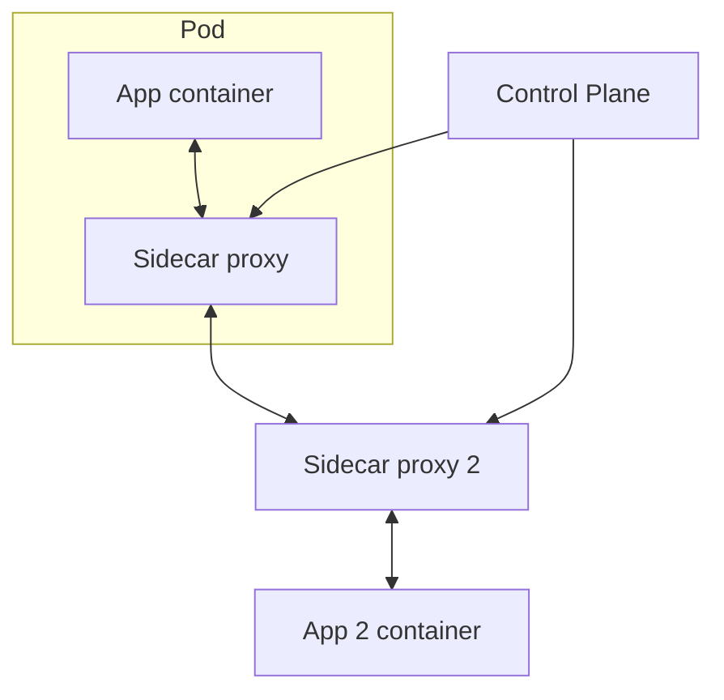

# Service Mesh in System Design 📌

## Table of Contents

- [Introduction](#introduction)
- [Prerequisites & Related Topics](#prerequisites--related-topics)
- [Pattern Recognition Guide](#pattern-recognition-guide)
- [What a Mesh Adds](#what-a-mesh-adds)
- [Data Plane vs Control Plane](#data-plane-vs-control-plane)
- [Adoption Path](#adoption-path)
- [Trade-offs](#trade-offs)
- [Edge Cases to Consider](#edge-cases-to-consider)
- [Common Pitfalls](#common-pitfalls)
- [FAQ](#faq)
- [Interview Tips](#interview-tips)
- [Real-World Examples](#real-world-examples)
- [Advanced Topics](#advanced-topics)
- [Further Reading](#further-reading)

## Introduction

A service mesh is a dedicated infrastructure layer for **service-to-service (east-west) communication**: it injects a proxy (a "sidecar") next to every service instance, and those proxies handle retries, timeouts, mTLS, traffic shifting, and telemetry so service code doesn't have to. The mesh takes policies from a **control plane** and pushes them to the **data plane** of sidecars.

## Prerequisites & Related Topics

- **Builds on**: [Microservices](../scalability/microservices.md), [Proxies](../system-basics/proxies.md) (a sidecar *is* a reverse proxy per service), [API Gateway](../architecture/api-gateway.md) (the mesh's edge)
- **Used in**: Kubernetes-heavy platforms, multi-team microservice estates, zero-trust rollouts
- **Techniques often combined**: mTLS identity, outlier ejection, circuit breaking, canary routing, distributed [tracing](../observability/distributed-tracing.md)
- **See also**: [Zero Trust](../security/zero-trust.md) — mesh mTLS is the standard implementation vehicle

## Pattern Recognition Guide

### 🎯 When to Use a Service Mesh

**Keywords in requirements**: "service-to-service auth", "zero trust", "canary between services", "retries everywhere", "per-request observability between services", "hundreds of microservices"
**Reach for this when**:
- Many services in many languages need the *same* resilience and security policy
- mTLS identity between services is required (compliance, zero-trust)
- Traffic shifting (canary, mirroring, headers) must be controlled platform-wide
- You need consistent per-call metrics/traces without touching each codebase

### 🔑 Approach Indicators

| Approach | Signals | Best For |
|----------|---------|----------|
| Full mesh (Istio, Linkerd) | platform team, many services | large polyglot estates |
| Sidecar-less / eBPF mesh (Cilium) | data-path overhead matters | performance-sensitive clusters |
| Library-only (Hystrix/resilience4j) | single stack, few services | small homogeneous fleets |
| Gateway-only | limited east-west complexity | early microservices stage |

### ❌ When NOT to Use

- Fewer than ~a dozen services or one runtime — libraries and a gateway are cheaper
- Team lacks platform-ops capacity — a broken mesh takes the platform down
- Data paths where proxy hops break latency budgets — route critical hops around the mesh or use sidecar-less variants

## What a Mesh Adds

- **mTLS everywhere** — automatic workload identities and encrypted service-to-service links; the zero-trust primitive delivered by default.
- **Uniform resilience** — retries with budgets, timeouts, circuit breaking, outlier ejection — configured once per route, applied to every language.
- **Traffic management** — weighted canary shifts, header-based routing, fault injection for [chaos testing](../testing/chaos-engineering.md).
- **Telemetry** — per-hop latency, error ratios, and request traces without SDK changes.
- **Policy enforcement** — L7 authorization ("orders can read billing, nothing else").

## Data Plane vs Control Plane

- **Data plane**: the sidecars/proxies that actually forward every request. Fast, per-pod, language-agnostic.
- **Control plane**: consumes declarative config, distributes policies and certificates, aggregates telemetry into a graph.
- Interview framing: "The control plane is the brain but is *not* on the request path — if it dies, forwarding continues on last-known-good policy."

## Adoption Path

1. Start with a **gateway** at the edge (north-south) — most problems are there first.
2. Add **library-based resilience** inside a homogeneous stack if you have one.
3. Adopt the **mesh** when polyglot fleets, zero-trust mandates, or fleet-wide traffic control outweigh the operational tax.
4. Consider **sidecar-less/ambient** meshes to cut the per-pod resource and latency overhead.

## Trade-offs

| Choice | Pros | Cons | Best For |
|--------|------|------|----------|
| Full mesh | uniform mTLS, policy, telemetry | operational complexity, per-hop latency/resource cost | many polyglot services |
| Ambient/sidecar-less mesh | less overhead, simpler rollout | newer, less mature patterns | Kubernetes platforms |
| Library resilience (resilience4j) | zero proxy hops, code-native | per-language reimplementation, drift | single-stack fleets |
| No mesh, gateway only | simplest, fewest moving parts | no east-west enforcement, no unified telemetry | <10 services |

**Platform code vs app code:** the mesh moves resilience out of libraries into infrastructure — less duplication, but now a platform team owns the most critical hop in the system.

**Observability vs overhead:** every hop adds a proxy (CPU, ~sub-millisecond to a few ms latency). Fine for most APIs; painful for hot internal paths.

**Uniformity vs autonomy:** central control-plane policy is powerful, but service teams lose "just deploy" independence when rollout requires mesh config review.

> **⚠️ When NOT to adopt a mesh:** a monolith or a handful of services, teams without platform engineering, latency-critical internal hot paths — a mesh is a platform investment, not a feature.

## Edge Cases to Consider

- Control plane outage — data plane keeps forwarding; be ready to explain what degrades (cert rotation, policy updates)
- Sidecar crash or OOM — pod loses its traffic path; readiness must probe the sidecar too
- Latency budgets on hot internal paths — consider direct links or sidecar-less data planes
- Long-lived connections (gRPC/WebSockets) — need connection-aware balancing, not naive round-robin
- mTLS rollouts mid-traffic — PERMISSIVE mode first, then STRICT

## Common Pitfalls

1. Adopting a mesh before containers/platform maturity — the mesh inherited its chaos
2. Assuming the mesh fixes bad service boundaries — it operatalizes what exists
3. No latency budget accounting for the extra hops
4. Default global retry settings multiplying retries into storms (flush retry budgets end to end)
5. Treating the mesh as the security boundary *instead of* per-service authz

## FAQ

**Q1: Service mesh vs API gateway?**

A: Gateway handles north-south (client→platform); the mesh handles east-west (service↔service). Most real platforms run both and pass identity between them.

**Q2: Is a mesh worth it for a small system?**

A: Usually not — fetch a gateway plus libraries (timeouts, retries, mTLS at the LB) until the fleet-polyglot or zero-trust forces genuinely outweigh the operational tax.

**Q3: Where does a mesh's "mTLS for free" come from?**

A: The control plane issues per-workload certificates (often SPIFFE identities), rotates them, and sidecars negotiate TLS transparently — the app keeps speaking plain HTTP to its sidecar.

## Interview Tips

### 1. Key Considerations

- How many services and languages actually need unified policy?
- Who operates the control plane, and what happens when it's down?
- Latency/resource overhead per hop — does every path tolerate it?
- Identity model: how do services authenticate, and who can call whom?

### 2. Common Questions

1. Design inter-service communication for 200 microservices in 5 languages.
2. How would you implement zero-trust service-to-service auth?
3. How do you roll out canary releases between internal services?
4. When would you *not* recommend a service mesh?

### 3. One-Liner to Land

"A mesh is the east-west counterpart of the API gateway: sidecar proxies give every service the same mTLS identity, retries, routing, and telemetry — configured once, in infrastructure instead of every codebase."

## Real-World Examples

- **Fin-tech/zero-trust platforms:** mTLS mesh identities replacing static credentials across hundreds of services.
- **Traffic shifting:** Envoy-based canary with gradual weight increases and automatic rollback on error-rate spikes.
- **Ambient mesh adoption:** clusters trimming per-pod overhead by moving L4 handling to node-level proxies.

## Advanced Topics

1. SPIFFE/SPIRE workload identity and cert rotation models
2. Sidecar-less meshes (Istio ambient, Cilium) — L4 at node, L7 where needed
3. Multi-cluster / multi-region mesh federation
4. Wasm extensions in proxy data planes

## Further Reading

- [Istio Concepts](https://istio.io/latest/docs/concepts/)
- [Linkerd Documentation](https://linkerd.io/2/overview/)
- [The Service Mesh: patterns (InfoQ)](https://www.infoq.com/articles service-mesh-architecture/)
- [Buoyant: What's a service mesh?](https://www.buoyant.io/what-is-a-service-mesh)
