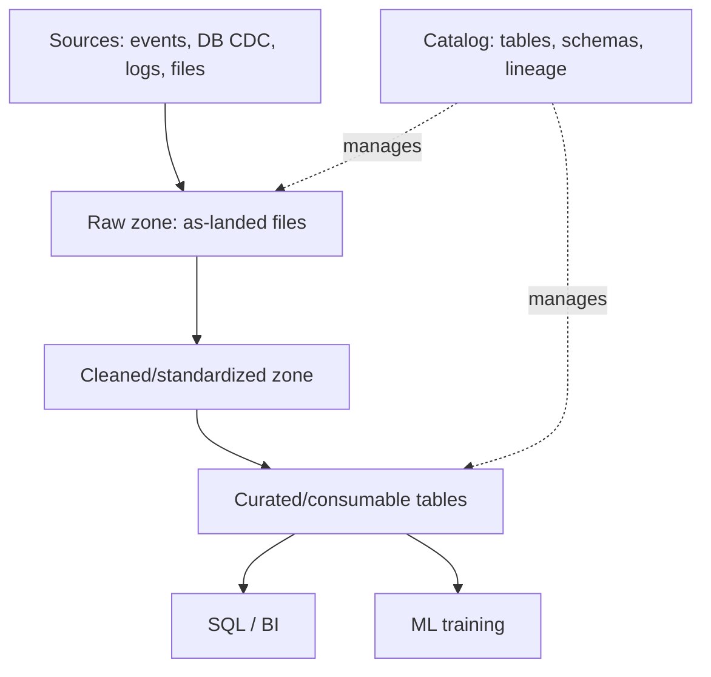

# Data Lake in System Design 📌

## Table of Contents

- [Introduction](#introduction)
- [Prerequisites & Related Topics](#prerequisites--related-topics)
- [Pattern Recognition Guide](#pattern-recognition-guide)
- [Lake Architecture](#lake-architecture)
- [Table Formats & Lakehouses](#table-formats--lakehouses)
- [Zones & Data Mesh Governance](#zones--data-mesh-governance)
- [Trade-offs](#trade-offs)
- [Edge Cases to Consider](#edge-cases-to-consider)
- [Common Pitfalls](#common-pitfalls)
- [FAQ](#faq)
- [Interview Tips](#interview-tips)
- [Real-World Examples](#real-world-examples)
- [Advanced Topics](#advanced-topics)
- [Further Reading](#further-reading)

## Introduction

A data lake is a centralized repository storing raw data at scale in its native format — logs, events, DB extracts, images, whatever exists — on cheap object storage. It decouples *ingesting* data (fast, cheap, append-only) from *structuring* it (lazy, per-use-case). The modern incarnation is the **lakehouse**: lake economics plus table formats (Iceberg/Delta/Hudi) that bring ACID transactions, schema evolution, and SQL over the files.

## Prerequisites & Related Topics

- **Builds on**: [Data Pipelines](data-pipeline.md), [Data Warehousing](data-warehousing.md) (curated zone often serves the warehouse), [OLAP vs OLTP](olap-vs-oltp.md)
- **Used in**: ML training pipelines, log/analytics archival, multi-tenant analytics platforms
- **Techniques often combined**: table formats (Iceberg, Delta, Hudi), columnar formats (Parquet), partitioning, compaction
- **See also**: [Data Quality](data-quality.md), [Data Privacy](../compliance/data-privacy.md)

## Pattern Recognition Guide

### 🎯 When to Use a Data Lake

**Keywords in requirements**: "store everything raw", "petabytes", "schema-on-read", "ML training data", "archives", "multiple use cases from one data set", "auditable history"
**Reach for this when**:
- Data types are heterogeneous and use cases unknown at ingest (capture first, structure later)
- Volume makes warehouse-only economics painful
- ML/training data needs columnar scans over years of history
- Retention/compliance requires immutable, versioned raw archives

### 🔑 Approach Indicators

| Approach | Signals | Best For |
|----------|---------|----------|
| Plain object storage + query engine | ad-hoc exploration, few tables | starting out |
| Lakehouse table format (Iceberg/Delta) | concurrent writers, updates, SQL | mature multi-team analytics |
| Schema-on-read only | fast ingest, unknown users | raw exploration zones |
| Schema-on-write for curated zone | BI/ML consumers need reliable tables | serving queries/training |

### ❌ When NOT to Use

- A single well-understood workload on modest data — the warehouse/DB alone is simpler
- Latency-critical serving paths — lakes are analytics substrates, not app databases
- Team can't afford governance — an ungoverned "data swamp" is the classic failure mode

## Lake Architecture

- **Raw / landing zone**: data as it arrives; immutable, versioned, retained long. Your "undo" record.
- **Cleaned / standardized zone**: parsed, typed, deduplicated; consistent columnar formats.
- **Curated / consumption zone**: tables shaped for actual consumers — BI marts, feature tables, training datasets. *(Same zones conceptually appear inside warehouses as staging/marts — see [Warehousing](data-warehousing.md).)*
- **Catalog & governance layer**: names, schemas, lineage, permissions across all of the above.

**Back-of-envelope:** 50k events/s × 1 KB → ~4 TB/day; storing raw + curated (2× compressed Parquet) at S3-class prices (~$25/TB-month) costs ~$200/month per day-of-data-retained — cheap enough to keep raw copies of everything, expensive enough to structure deliberately if you query often.

## Table Formats & Lakehouses

**How it works — open table formats:** tables are directories of Parquet files plus a metadata layer recording versions/snapshots (Iceberg) or an ACID transaction log (Delta/Hudi). This buys:

- **ACID around file commits** — writers no longer corrupt readers
- **Schema evolution** — add/rename columns without rewriting files
- **Time travel** — query data as of a previous snapshot (audit/debug gold)
- **Partition pruning** + row-level deletes/updates (merging warehouse features into the lake)

**File formats:** row formats (JSON/Avro) suit streaming ingestion; **columnar (Parquet)** suits analytic scans (read only needed columns, compress by type). Files sized ~100–500 MB; layout (partition by date, sort within partitions) decides query cost.

## Zones & Data Mesh Governance

- **Access tiers & ownership**: raw zone is pipeline-owned (writers only); curated zones have product owners with SLAs. Throwaway access policies for exploration.
- **Lineage & discoverability**: which pipeline wrote this table, from what sources, with what contract — the difference between a lake and a swamp.
- **GDPR at scale**: deletion requests over petabytes generally resolved via partition-level removal + time-bound re-incarnation windows; design *for* erasure, don't retrofit it (see [Data Privacy](../compliance/data-privacy.md)).
- **Cost controls**: lifecycle policies (raw → infrequent-access → glacier), compaction to fix small-file overhead, per-team storage/query attribution.

## Trade-offs

| Choice | Pros | Cons | Best For |
|--------|------|------|----------|
| Warehouse-only, no lake | governance, simple | storage economics at petabyte scale, raw retention | traditional BI |
| Lake raw-only + warehouse for serving | cheap capture | dual duplication, pipeline sprawl | transition phase |
| Lakehouse (table formats on object storage) | one platform, ACID + SQL on cheap storage | newer tooling maturity | most greenfield analytics |

**Schema-on-read vs schema-on-write:** read-time flexibility speeds ingestion but pushes correctness onto every careless consumer; write-time schemas in the curated zone protect the BI/ML path.

**Object storage alone vs table formats:** raw object storage is maximally flexible but offers no ACID, no schema history; table formats add warehouse-like guarantees with negligible cost — the default recommendation today.

> **⚠️ When NOT to dump everything into a lake:** regulated/hard-to-eradicate personal data without an erasure plan, data with zero identified consumers (decide first, ingest second), and latency-critical serving paths.

## Edge Cases to Consider

- GDPR erasure across immutable/raw zone snapshots — plan retention windows and tombstone processes up front
- Small-file explosion from frequent streaming commits — compaction jobs
- Schema drift from upstream producers — contracts + validation gates
- Partition layout that fits one query pattern and destroys another
- Cross-region replication latency and analytic consistency expectations
- Catalog unavailability halting all reads (metadata is the real SPOF)

## Common Pitfalls

1. Ingest-first thinking → the data swamp: years of undocumented, duplicated, orphaned data
2. No compaction — small-file Parquet kills both read and metadata paths
3. Storing everything as JSON and scanning it raw — no compression/columnar pruning
4. Treating curated tables as production data with zero contracts or fresh-team ownership
5. Forgetting erasure design until a deletion request arrives
6. No storage lifecycle — paying hot-tier prices for 7-year-old raw logs

## FAQ

**Q1: Lake or warehouse?**

A: They've converged — modern lakehouse table formats give warehouse semantics on lake economics. Old-school warehouses still win for mature BI governance; lakes win when raw retention, ML data, and volume dominate. Most big shops now run both layers via lakehouse patterns.

**Q2: How do you make a lake queryable?**

A: Layered: raw files → curated tables in a table format with a catalog + query engine (Presto/Trino/Spark/Athena-style) → serving views for BI. Columnar formats + partitioning decide the actual query cost.

**Q3: Where do ACID transactions fit if it's just files?**

A: The table format's metadata layer (snapshot/commit log) serializes writers — readers see consistent snapshots; updates are row-level deltas hidden by compaction. That's the "house" part of lakehouse.

## Interview Tips

### 1. Key Considerations

- Zone topology and who owns the write path
- Table format, partition/sort keys, expected file sizes
- Schema contracts on ingestion
- Erasure, retention, and cost lifecycle controls

### 2. Common Questions

1. Design the data platform for a ride-hailing app: events, trips, and ML training data.
2. How would you support analytics over 100 TB of raw user activity with 3-year retention?
3. Design GDPR erasure across years of raw event archives.
4. How would you serve BI and ML training from one platform without duplicating storage?

### 3. One-Liner to Land

"Object storage at the bottom, a table format over it (Iceberg-style: Parquet files + snapshot metadata for ACID and time travel), zones from raw → curated, with schema contracts at ingestion and lifecycle/erasure policies built from day one."

## Real-World Examples

- **Netflix:** S3-based lake plus platform tooling (Genie, Metacat catalogs) mediating thousands of jobs across raw and curated zones.
- **Uber:** Hudi open-sourced from its lake to solve incremental updates/upserts over trip data.
- **Media/retail archiving:** clickstream + logs retained raw for years; curated Parquet as the analytical layer.

## Advanced Topics

1. Lakehouse internals: snapshot isolation, manifest pruning, optimistic concurrency in Iceberg/Delta/Hudi
2. Row-level CDC merging into table formats (Hudi MOW/COW strategies)
3. Data mesh: domain-owned data products with federated catalogs
4. Open catalogs / catalogs federation (Polaris, Unity, Nessie-style branching)

## Further Reading

- [Project Nessie / Iceberg documentation](https://iceberg.apache.org/docs/latest/)
- [Delta Lake documentation](https://delta.io/)
- [Apache Hudi documentation](https://hudi.apache.org/docs/overview/)
- [Designing Data-Intensive Applications — Ch. 10 (batch), Ch. 11 (streams)](https://dataintensive.net/)
