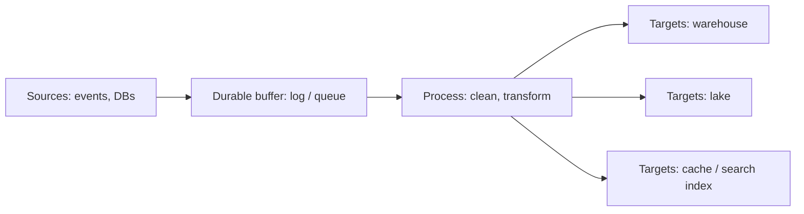

# Data Pipelines in System Design 📌

## Table of Contents

- [Introduction](#introduction)
- [Prerequisites & Related Topics](#prerequisites--related-topics)
- [Pattern Recognition Guide](#pattern-recognition-guide)
- [Pipeline Anatomy](#pipeline-anatomy)
- [Batch vs Streaming](#batch-vs-streaming)
- [Reliability Primitives](#reliability-primitives)
- [Orchestration & Monitoring](#orchestration--monitoring)
- [Trade-offs](#trade-offs)
- [Edge Cases to Consider](#edge-cases-to-consider)
- [Common Pitfalls](#common-pitfalls)
- [FAQ](#faq)
- [Interview Tips](#interview-tips)
- [Real-World Examples](#real-world-examples)
- [Advanced Topics](#advanced-topics)
- [Further Reading](#further-reading)

## Introduction

A data pipeline moves data from where it's produced (apps, events, databases) to where it's consumed (warehouses, lakes, caches, ML training) — reliably, at scale, and on time. Every non-trivial system design answer eventually has one: "how does user activity get to the recommendation model?" The interview version of this question is really about *delivery semantics, ordering, and recovery*.

## Prerequisites & Related Topics

- **Builds on**: [Message Queues](../architecture/message-queues.md), [Event-Driven architecture](../scalability/event-driven.md)
- **Used in**: [Data Warehousing](data-warehousing.md), [Stream Processing](stream-processing.md), [Data Lake](data-lake.md) ingestion
- **Techniques often combined**: CDC, idempotent writes, dead-letter queues, watermarking
- **See also**: [Data Quality](data-quality.md) — validation gates live inside pipelines

## Pattern Recognition Guide

### 🎯 When to Design a Data Pipeline

**Keywords in requirements**: "analytics", "feed a recommendation model", "aggregate events", "sync warehouses", "real-time dashboards", "daily reports"
**Reach for this when**:
- Producers and consumers evolve on different cadences and scales
- Events arrive continuously but consumers need any of: dashboards, aggregates, training sets
- Cross-system replication (OLTP → OLAP, cache invalidation, search indexing)

### 🔑 Approach Indicators

| Approach | Signals | Best For |
|----------|---------|----------|
| Batch ETL | "daily", "hourly", simple SQL transforms | reports, low-latency-tolerant analytics |
| Streaming | "real-time", "within seconds", "live" | fraud, alerts, live metrics |
| CDC | "keep in sync", "incremental", no source impact | DB → warehouse/index/cache |
| Lambda (batch + speed layers) | streaming for freshness *and* batch for truth | heavy reprocessing needs |
| Kappa (stream-only) | reprocess by replaying the log | simpler ops, replayable sources |

### ❌ When NOT to Use

- One-off migrations — a script beats a pipeline
- Source of truth stays queryable and consumers can query directly — skip the copy
- Requirements fully served by one query on one database — don't build a "platform" around it

## Pipeline Anatomy

1. **Extraction** — push (apps emit events), pull (periodic query), or CDC (tail the WAL/binlog).
2. **Buffer** — a durable, ordered log (Kafka-style) decouples producer rate from consumer rate and survives consumer downtime.
3. **Process** — clean (schema, enforce types), transform (joins, aggregates), validate (see [Data Quality](data-quality.md)).
4. **Load** — idempotent, schema-aware writes into the target; contract the target's mutation behavior (append-only vs upsert).
5. **Orchestrate & observe** — dependencies, schedules, SLAs, and alerting on freshness/volume.

## Batch vs Streaming

| Dimension | Batch | Streaming |
|-----------|-------|-----------|
| Latency | minutes–hours | seconds |
| Semantics | re-run whole datasets; simplest to reason about | per-event; needs exactly-once or idempotency care |
| Cost model | spot/ephemeral compute, deep idle-tolerant | always-on, sized for peak |
| Failure recovery | re-run the batch | checkpointing + replay from offsets |
| When it wins | finance reporting, ML training sets | user-facing personalization, alerting |

**Lambda architecture** runs both (speed view for freshness, batch for authoritative truth) and merges at query time — powerful but you maintain two codebases. **Kappa** runs everything through the stream and serves corrections by replay — simpler ops when the log is a trustworthy source.

## Reliability Primitives

- **Delivery semantics**: at-least-once defaults to the industry reality. Exactly-once end-to-end is rare/expensive; the standard design is at-least-once + **idempotent processing** (dedupe by event ID, upsert keys).
- **Backpressure**: consumers must propagate "I'm slow" — bounded buffers and pause/resume, not unbounded in-memory queues.
- **Dead-letter queues**: poison events quarantined, not dropped or blocking.
- **Checkpointing/offsets**: processors record their position in the log; crash → resume from checkpoint, replaying to recreate state.
- **Schema evolution**: producers write with registered schemas; readers validate against them. Additive changes only (new optional fields) to keep old consumers alive.
- **Cloning & replayability**: every stage should be re-runnable from durable input without affecting live output.

## Orchestration & Monitoring

- **DAG scheduling** (Airflow/Dagster-style): pipelines declared as dependency graphs with retries per task, timeouts, and backfills on demand.
- **Freshness and volume SLOs**: alert when today's row counts or event rates deviate from partition-vs-seasonal baselines; most data incidents are silent *until someone looks*.
- **Lineage tracking**: which upstream feed this report; failure blast-radius tracing.
- **Backfills**: designed-from-day-one paths to recompute historical data after a logic change.

## Trade-offs

| Choice | Pros | Cons | Best For |
|--------|------|------|----------|
| Batch | simple to reason about and re-run | latency, end-of-period clustering | reporting, training data |
| Streaming | freshness, event-by-event reaction | harder exactly-once, peak sizing | alerts, live personalization |
| Lambda | freshness + authoritative batch | two codebases, merge complexity | heavy, evolving reprocessing |
| Kappa | one paradigm, replay-driven | log retention/replay must be bulletproof | long-retention replayable event streams |
| CDC | no source polling load, incremental truth | schema-change coupling, log access | DB replication targets |

**Exactly-once vs at-least-once + idempotency:** true exactly-once across producer/log/consumer is complex and costly; idempotent consumers usually win the design argument in interviews.

**Schema flexibility vs safety:** schemaless payloads are great for writers, terrible for readers years later — define schemas backward-compatible (avro/proto semantics) and validate at write time.

> **⚠️ When NOT to over-engineer the pipeline:** don't add streaming/Kappa to satisfy an imaginary real-time need; establish a latency requirement from the actual business question first.

## Edge Cases to Consider

- Duplicate events from at-least-once delivery — idempotency at every consumer
- Late-arriving events skewed into the wrong partition/window
- Clock skew between producers breaking event ordering
- Schema changes shipping after consumers updated (contract-first)
- Backpressured upstreams feeding graph databases/cache stores ahead of writes
- Retention runtimes when a consumer is down for hours — offsets pin memory indefinitely
- GDPR-delete *upstream at the source* vs downstream copy-ers

## Common Pitfalls

1. Silent freshness breakage — SLO alerting on data age is a requirement, not polish
2. Dual-write producers (write to DB + emit separately) — inconsistent under partial failure; prefer CDC or transactional outbox
3. No idempotent consumers — replay corrupts every aggregate
4. Unbounded retry of a poison message stalling a partition
5. Testing pipelines only on sample data — volumes and skew flip everything
6. Transform logic duplicating business rules without provenance

## FAQ

**Q1: At-least-once or exactly-once processing?**

A: Build for at-least-once plus idempotent consumers — idempotency keys or dedupe tables make duplicates harmless; "exactly-once" end-to-end is possible in closed systems (e.g., Flink with transactional sinks) but rarely worth the coupling.

**Q2: Batch or streaming for my design?**

A: From the requirement's latency tolerance: "T+1 report" → batch; "notify within seconds" → streaming; both (dashboards + monthly audits on the same data) → consider Kappa with a serving layer, or explicit Lambda with a merge plan.

**Q3: How do you handle a bad event?**

A: Dead-letter it with the original payload plus validation error, keep the pipeline moving, and page a human on DLQ depth — never drop silently and never block the partition forever.

## Interview Tips

### 1. Key Considerations

- Producer/consumer decoupling (durable log vs direct calls)
- Ordering needs and their relationship to partition key design
- Failure recovery story: checkpoints, replays, idempotency
- Freshness SLO and its monitoring

### 2. Common Questions

1. Design the data pipeline for a ride-hailing surge-pricing model.
2. How would you sync an OLTP database into a warehouse every night?
3. Design fraud detection with sub-second alerting on card transactions.
4. How would you GDPR-erase a user across all derived datasets?

### 3. One-Liner to Land

"Producers append to a durable log, consumers checkpoint and re-run idempotently — so the pipeline survives outages and replays without double counting."

## Real-World Examples

- **Uber:** trips/pricing analytics via streaming + batch, lambda-style, with explicit gauges for freshness.
- **E-commerce order events** → warehouse for BI, cache invalidation events for catalogs, training \fraud model.
- **Change data capture** at scale (LinkedIn Databus/Debezium lineage) — database rows as streams for caches/search/analytics.

## Advanced Topics

1. Transactional outbox pattern for atomic write+publish
2. Watermarks and event-time processing semantics in stream processors
3. Data contracts: schema/SLA agreements between producer and consumer teams
4. Incremental computation models (materialize-view style engines)

## Further Reading

- [Designing Data-Intensive Applications — Chapter 11](https://dataintensive.net/)
- [The Lambda and Kappa Architectures](https://martinfowler.com/articles/lambda-architecture.html) (Fowler)
- [Kafka Documentation — delivery semantics](https://kafka.apache.org/documentation/#semantics)
- [Debezium CDC Documentation](https://debezium.io/documentation/)
