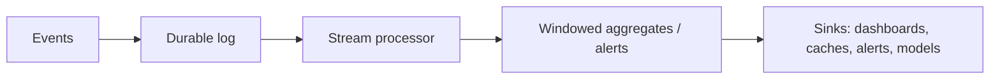

# Stream Processing in System Design 📌

## Table of Contents

- [Introduction](#introduction)
- [Prerequisites & Related Topics](#prerequisites--related-topics)
- [Pattern Recognition Guide](#pattern-recognition-guide)
- [Core Abstractions](#core-abstractions)
- [Windows & Time Semantics](#windows--time-semantics)
- [State & Fault Tolerance](#state--fault-tolerance)
- [Joining Streams](#joining-streams)
- [Architectural Roles](#architectural-roles)
- [Trade-offs](#trade-offs)
- [Edge Cases to Consider](#edge-cases-to-consider)
- [Common Pitfalls](#common-pitfalls)
- [FAQ](#faq)
- [Interview Tips](#interview-tips)
- [Real-World Examples](#real-world-examples)
- [Advanced Topics](#advanced-topics)
- [Further Reading](#further-reading)

## Introduction

Stream processing reacts to data as it arrives — computing aggregates, detecting patterns, and enriching events within seconds rather than waiting for a nightly batch. It's the difference between *"we flagged the fraudulent card tomorrow"* and *"we flagged it mid-transaction."* The design conversation always converges on three things: **time (event vs processing), state (how it survives failures), and delivery semantics (what happens on replay).**

## Prerequisites & Related Topics

- **Builds on**: [Data Pipelines](data-pipeline.md), [Message Queues](../architecture/message-queues.md), [Event-Driven Architecture](../scalability/event-driven.md)
- **Used in**: [Real-time Analytics](real-time-analytics.md), fraud detection, live [Monitoring](../system-basics/monitoring.md) and [Alerting](../observability/alerting.md)
- **Techniques often combined**: watermarking, checkpointed state stores, exactly-once sinks, CEP (complex event processing)
- **See also**: [Data Warehousing](data-warehousing.md) — the batch counterpart most pipelines also feed

## Pattern Recognition Guide

### 🎯 When to Use Stream Processing

**Keywords in requirements**: "real-time", "within seconds", "live", "flag/detect as it happens", "rolling window", "alert immediately", "as events arrive"
**Reach for this when**:
- Value decays fast with delay (fraud, anomaly detection, pricing)
- Rolling aggregates feed live dashboards or user-facing features
- Continuous enrichment (clickstre joining user profiles) before routing
- The trigger condition spans multiple events over time (sessions, sequences)

### 🔑 Approach Indicators

| Approach | Signals | Best For |
|----------|---------|----------|
| Lightweight pub/sub consumers | single-stateless filters, simple alerts | routing, notifications |
| Full stream processor (Flink/Kafka Streams-style) | windows, joins, stateful logic | sessions, fraud, rolling metrics |
| Stream-to-batch hybrid | correctness audits on top of live views | finance-grade pipelines |
| CEP (pattern matching) | sequences like "3 failures in 5 min" | fraud, incident detection |

### ❌ When NOT to Use

- Latency tolerance ≥ minutes — a batch job or simple queue consumer is cheaper and simpler
- One-shot queries over historical data — that's [warehousing](data-warehousing.md)
- Team can't operate state stores and checkpointing — a broken stream pipeline is worse than a slow one

## Core Abstractions

- **Event**: immutable, timestamped record (what happened, when — *event time*, not receive time).
- **Stream**: unbounded, ordered-by-key sequence of events (partitioned by key to preserve per-key order).
- **Processor / topology**: DAG of stateless maps/filters and stateful aggregators/joins.
- **State store**: keyed, persistent state (RocksDB-style local store backed by changelog topics) so aggregates survive restarts.
- **Sink**: where results land — dashboards, caches, alert routers, feature stores.

## Windows & Time Semantics

| Window | How it works | Use for |
|--------|--------------|---------|
| Tumbling | fixed, non-overlapping segments (1-min buckets) | simple metrics, billing intervals |
| Hopping | sliding with overlap (5-min window every 1 min) | smoothed trends |
| Sliding | continuously updated "last N minutes" | rate limiting, anomaly thresholds |
| Session | gap-based (close after X minutes of inactivity) | user sessions |

**Event time vs processing time** — the classic interview trap: events arrive late (network delay, offline-then-reconnect devices). Buckets keyed on *processing* time silently mis-bucket late data; **watermarks** declare "we believe all events up to T have arrived" so windows can finalize correctly, with a side channel (or allowed-lateness bucket) for stragglers.

## State & Fault Tolerance

- **Checkpointing**: periodically snapshot the processor's state + source offsets atomically; on crash, restore state and resume from the offsets — no lost or double-processed events *within the framework*.
- **Exactly-once claims**: real exactly-once requires the source, processing, and *sink* to cooperate (transactional writes, or idempotent/upsert sinks). End-to-end exactly-once to arbitrary sinks is rare — idempotent sinks are the standard answer.
- **State sizing/backpressure**: state grows with key cardinality and window length; plan retention (state TTL) or you'll OOM.
- **Replay**: recovery = replay the log from checkpointed offsets; correctness depends on idempotent or transactional output.

## Joining Streams

- **Stream–stream (interval join)**: events of two streams joined if their event-times fall in a bounded window (click ↔ impression within 30 min). State holds both sides until the window closes — watermark-driven.
- **Stream–table (enrichment)**: events enriched against a slowly-changing reference (events × current user profile); the table side is a changelog stream the processor materializes locally.
- **Global vs keyed placement**: both sides of a join must be co-partitioned by the join key — mis-keyed partitioning silently drops matches.

## Architectural Roles

- **Detector**: threshold/sequence rules over windows → alerts.
- **Rolling aggregator**: per-minute/per-5-min metrics feeding live dashboards (complements [Metrics](../observability/metrics.md)).
- **Enricher**: join clickstream with profile/product data before routing downstream.
- **Feature fabricator**: per-entity live features (user's avg order in last hour) for ML serving.
- **Router/splitter**: classify and dispatch events to different consumers with per-topic contracts.

## Trade-offs

| Choice | Pros | Cons | Best For |
|--------|------|------|----------|
| Stateless consumers only | trivially scalable, no checkpoints | can't aggregate/join | filtering, routing |
| Stateful stream processor | windows, joins, sessions | operational weight, state management | fraud, sessions, analytics |
| Storm-style record-at-a-time | simple mental model | weak time semantics | legacy/simple topologies |
| Micro-batch streaming | throughput efficiency, simple retries | bounded latency floor | near-real-time ETL |

**Freshness vs completeness:** the earlier a window closes, the fresher the result but the more late events get mis-bucketed — watermark delay is a business decision (how late can data be?).

**State in processor vs external store:** local state is fast but coupled to the processor's lifecycle; external stores (Redis/DB) are shared but add a network hop and their own consistency issues.

**Event time vs processing time:** event time gives correct history and reprocessable windows; processing time is simpler but lies under delay spikes.

> **⚠️ When NOT to reach for streaming:** if no one reacts within the minute, streaming burns money for nothing — batch to the warehouse and a dashboard satisfies the true requirement.

## Edge Cases to Consider

- Late events beyond the watermark — policy: drop, side-output, or extend lateness budget
- Skewed keys (celebrity user) — one partition/hot state; salt keys or split aggregates
- Out-of-order per-key guarantees broken by repartitioning
- State TTL vs legal retention requirements
- Duplicate events after consumer rebalance — idempotent sinks required
- Timezone-shifted session windows for global user bases
- Task failover mid-window — checkpoints restore exactly-consistent state

## Common Pitfalls

1. Bucketing on processing time and mis-bucketing late data silently
2. Unbounded state — no TTL on session state until the cluster OOMs
3. Assuming exactly-once all the way to the sink without an idempotent or transactional sink
4. Hot-key skew melting one task while others idle
5. No tooling to inspect/repair state — debugging a live topology becomes archaeology
6. Watermark delays tuned from vibes instead of measured lateness distributions

## FAQ

**Q1: Event time or processing time windows?**

A: Event time for anything correctness-sensitive (billing, fraud, analytics) — with watermarks to bound lateness; processing time only when "roughly now" is fine.

**Q2: How do you get exactly-once output?**

A: Framework checkpointing gives exactly-once *state recovery*; end-to-end exactly-once needs the sink on board (transactional writes) — otherwise design idempotent/upsert sinks and accept at-least-once internally.

**Q3: What happens when a stream task crashes?**

A: Restore the last checkpoint (state + offsets) on another node and replay from there — output continuity depends on idempotent/transactional sinks; freshness dips for the replay window.

**Q4: How do you handle a hot key?**

A: Two-phase aggregation: pre-aggregate with salting (key−1, key−2…) then final-merge by key; or route hot entities through dedicated partitions.

## Interview Tips

### 1. Key Considerations

- Which time domain matters (event vs processing) and the tolerated lateness
- State cardinality and retention (TTL) planning
- Delivery guarantees end-to-end, especially at the sink
- Skew and hot keys in the partitioning scheme

### 2. Common Questions

1. Design a real-time fraud detection pipeline for card transactions.
2. How would you compute "active users in last 5 minutes" at scale?
3. Design live leaderboards with per-second updates for 10M players.
4. How would you join a click stream with a slowly-changing product catalog?

### 3. One-Liner to Land

"Events partitioned by key into a durable log; stateful processors checkpoint state and use event-time watermarks so windows finalize correctly even with late data — sinks stay idempotent so replays are safe."

## Real-World Examples

- **Payment networks:** per-card velocity features (counts/sums over rolling windows) evaluate mid-authorization.
- **Uber/Lyft:** minute-level trip/hourly-demand aggregates driving surge pricing.
- **Netflix:** per-title playback QoE aggregates feeding real-time alerting ([Alerting](../observability/alerting.md)) and dashboards.

## Advanced Topics

1. Event-time sessionization with dynamic watermarks
2. Stream-table duality and changelog capture (Kafka Streams / Flink tables)
3. CEP engines: temporal pattern matching with negation ("no heartbeat in 60 s")
4. Exactly-once two-phase-commit sinks and idempotent upsert design

## Further Reading

- [Flink Documentation — Event Time & Watermarks](https://nightlies.apache.org/flink/flink-docs-stable/docs/concepts/time/)
- [Kafka Streams Developer Guide](https://kafka.apache.org/documentation/streams/)
- [Streaming Systems (book)](https://www.streamingsystems.net/)
- [Streaming 101 (Google, Tyler Akidau)](https://www.oreilly.com/radar/the-world-beyond-batch-streaming-101/)
