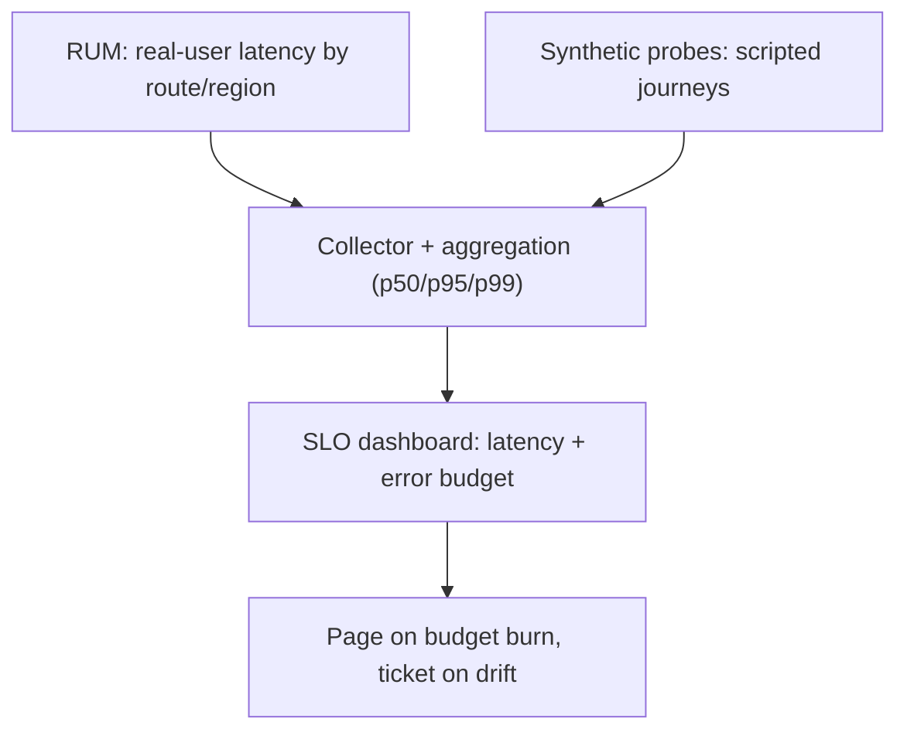

# Performance Monitoring in System Design 📌

## Table of Contents

- [Introduction](#introduction)
- [Prerequisites & Related Topics](#prerequisites--related-topics)
- [Pattern Recognition Guide](#pattern-recognition-guide)
- [Monitoring Components](#monitoring-components)
- [Implementation Strategies](#implementation-strategies)
- [Analysis Patterns](#analysis-patterns)
- [Common Use Cases](#common-use-cases)
- [Trade-offs](#trade-offs)
- [Edge Cases to Consider](#edge-cases-to-consider)
- [Common Pitfalls](#common-pitfalls)
- [FAQ](#faq)
- [Interview Tips](#interview-tips)
- [Advanced Topics](#advanced-topics)
- [Further Reading](#further-reading)

## Introduction

Performance monitoring provides insights into system behavior, resource utilization, and application performance.

### Key Benefits
1. **Performance Optimization**
2. **Resource Planning**
3. **Issue Prevention**
4. **Capacity Planning**
5. **User Experience**

See what users feel: real-user timing plus synthetic probes against SLOs.

## Prerequisites & Related Topics

- Builds on: [Metrics](metrics.md), [Distributed Tracing](distributed-tracing.md)
- Used in: [Load Testing](../testing/load-testing.md), [Performance Optimization](../best-practices/performance.md), [Capacity planning](../scalability/scaling-types.md)
- Techniques often combined: percentile tracking, RUM vs synthetic, per-endpoint budgets
- See also: [Core Web Vitals](https://web.dev/vitals/) — the user-facing performance contract

## Pattern Recognition Guide

### 🎯 When to Use Performance Monitoring

**Keywords in requirements**: "performance", "latency", "throughput", "p95/p99", "regression", "capacity", "bottleneck"
**Reach for this when**:
- Latency budgets per endpoint with regression alerts
- Capacity headroom tracking against growth forecasts
- Release comparison — p95 before/after deploys
- Dependency SLAs measured, not assumed

### 🔑 Approach Indicators

| Approach | Signals | Best For |
|----------|---------|----------|
| RUM (real users) | truth including networks | user-facing surfaces |
| Synthetic probes | controlled comparison | critical journeys |
| APM traces | per-hop attribution | regression root-causing |
| Profiling (continuous) | CPU/alloc hotspots | deep dives |

### ❌ When NOT to Use

- Averages as targets — tail users are the story
- Monitoring only prod top-line — per-endpoint budgets catch regressions early
- Profiling everything always — measure, then profile the hot path

## Monitoring Components

### 1. Metric Collection
**How it works — Metric collector:** agents or pull-scrapers gather from every endpoint on a schedule, batch, and forward to storage — the collector also reports an exporter that went silent (silence itself is signal).

### 2. Performance Profiling
**How it works — Performance profiler:** profile before optimizing — CPU samples, allocation profiles, and query plans turn "feels slow" into a ranked list of hot spots; the top of the list is the work, everything else is noise.

## Implementation Strategies

### 1. Real-time Monitoring
**How it works — Real time monitor:** sub-minute-resolution views on hot paths (live error rate, queue depth) for incident triage, backed by the slower downsampled series for history and comparisons.

### 2. Resource Monitoring
**How it works — Resource utilization view:** correlate the four saturations (CPU, memory, IO, network) with the latency percentiles on the same time axis — the p99 spike plus the CPU cliff at the same timestamp is the diagnosis, not a guess.

## Analysis Patterns

### 1. Performance Analysis
**How it works — Performance analyzer:** slice latency by endpoint and time window, compare against rolling baselines, then attribute regressions via traces or profiles — a p99 spike at 3 AM with latency-only graphs tells you nothing; the resource/tracing overlay tells you why.

### 2. Trend Analysis
**How it works — Trend analyzer:** compare like windows (week over week, year over year) to strip seasonality, track the slope not the spike, and alert on sustained deviation — trends catch the slow leak that threshold alerts never see.

## Common Use Cases

### 1. Web Application Monitoring
**How it works — Web app monitor:** browser-side RUM: page load, time-to-interactive, front-end error rates collected from real users — server green with client red is a CDN/JS bug that only RUM sees.

### 2. Database Performance
**How it works — Database monitor:** query latency percentiles, connection pool saturation, lock waits, and slow-query counts; DB metrics explain many app-level p99 spikes that app metrics alone cannot.

## Trade-offs

| Choice | Pros | Cons | Best For |
|----------|------|------|----------|
| Continuous profiling | Always-on optimization evidence | CPU overhead (low but nonzero) | Hot paths, capacity planning |
| On-demand profiling | Zero baseline cost | Misses intermittent issues | Chase specific regressions |
| Real-user monitoring (RUM) | True user experience | Privacy, sampling, client overhead | Customer-facing apps |
| Synthetic monitoring | Prober-controlled, comparable over time | Misses real-user diversity | Availability and journey checks |

**Resolution vs overhead:** Finer measurement intervals catch brief spikes but cost more to store and query.

**RUM vs synthetic:** Real users give truth with noise; synthetics give controlled comparability without real-world diversity — mature setups use both.

**Alert sensitivity:** Tight monitoring thresholds catch regressions early but page more; tune against SLO error budgets.

> **⚠️ When NOT to profile continuously:** environments where the overhead outweighs the insight, and short-lived jobs where sampling never converges — trigger profiling on SLO regression instead.

## Edge Cases to Consider

- Coordinated omission — measuring only when requests are sent hides queues
- Client-side metrics skew (ad blockers, sample bias)
- Multi-region aggregation masking one bad region
- Warm-up effects after deploys skew comparisons

## Common Pitfalls

1. No baselines — regressions have nothing to be regressions against
2. Alerting on mean latency only
3. Ignoring client-side performance where users actually wait
4. Tracking infra metrics without mapping to user journeys

## FAQ

**Q1: p95 or p99?**

A: Alert on p95 for broad regressions, track p99 for tail health; user-facing SLOs often commit to p95 with p99 as an error-budget guardrail.

**Q2: Synthetic or real-user monitoring?**

A: Both: RUM shows truth and distribution; synthetics give controlled comparisons and 24/7 path checks. Start synthetic on critical journeys, add RUM.

**Q3: How do I catch regressions automatically?**

A: Per-endpoint latency budgets with statistical gates on deploys — canary traffic compared against stable, auto-rollback on breach.

## Interview Tips

### 1. Key Considerations
- Metric selection
- Collection frequency
- Storage requirements
- Analysis methods
- Alert thresholds

### 2. Common Questions
1. How to monitor performance?
2. How to identify bottlenecks?
3. How to handle scaling?
4. How to optimize resources?

### 3. Best Practices
- Monitor key metrics
- Set baselines
- Implement alerts
- Regular analysis
- Capacity planning

## Advanced Topics

1. Continuous profiling (Pyroscope/Parca) tied to releases
2. SLO multi-window burn dashboards for performance
3. Load-test correlation: staging shapes vs production traffic
4. Per-tenant performance attribution for fair multi-tenancy

## Further Reading
- [Google SRE Book - Monitoring](https://sre.google/sre-book/monitoring-distributed-systems/)
- [Performance Monitoring Guide](https://www.datadoghq.com/blog/monitoring-101-collecting-data/)
- [Database Performance Tuning](https://use-the-index-luke.com/)

