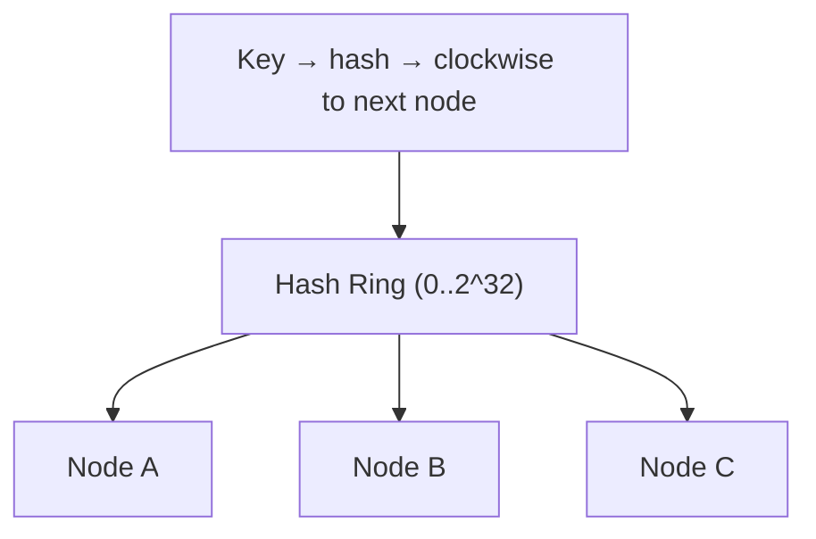

# Consistent Hashing in System Design 📌

## Table of Contents

- [Introduction](#introduction)
- [Prerequisites & Related Topics](#prerequisites--related-topics)
- [Pattern Recognition Guide](#pattern-recognition-guide)
- [How It Works](#how-it-works)
- [Virtual Nodes](#virtual-nodes)
- [Bounded Loads & Hotspots](#bounded-loads--hotspots)
- [Where Consistent Hashing Shows Up](#where-consistent-hashing-shows-up)
- [Trade-offs](#trade-offs)
- [Edge Cases to Consider](#edge-cases-to-consider)
- [Common Pitfalls](#common-pitfalls)
- [FAQ](#faq)
- [Interview Tips](#interview-tips)
- [Real-World Examples](#real-world-examples)
- [Advanced Topics](#advanced-topics)
- [Further Reading](#further-reading)

## Introduction

A naive hash placement strategy — `hash(key) % N` — shuffles almost every key to a new node each time the pool grows or shrinks. Consistent hashing maps keys onto a hash ring so that adding or removing a node only moves roughly **1/N** of the keys.

## Prerequisites & Related Topics

- **Builds on**: hashing fundamentals, [Distributed Systems](distributed-systems.md)
- **Used in**: [Database Sharding](database-sharding.md), [Load Balancing](load-balancing.md) (consistent-hash balancing), [CDN & Content Delivery](cdn-content-delivery.md) (edge selection), distributed [Caching](caching.md) clusters
- **Techniques often combined**: virtual nodes, bounded-load dispatch, rendezvous hashing, gossip membership
- **See also**: [Data Partitioning](../scalability/data-partitioning.md) — consistent hashing is the standard partition-placement strategy for caches and sharded stores

## Pattern Recognition Guide

### 🎯 When to Use Consistent Hashing

**Keywords in requirements**: "elastic scale", "add/remove servers to a cache", "minimize cache misses on resize", "consistent distribution", "hot key placement", "memcached cluster"
**Reach for this when**:
- A cache or shard pool grows and shrinks dynamically
- A request must consistently land on the same backend (request coalescing, sticky routing)
- Rebalancing cost (cache misses, data migration) must be proportional to the change, not total
- Multiple layers hash the same keys independently (edge + origin)

### 🔑 Approach Indicators

| Approach | Signals | Best For |
|----------|---------|----------|
| Simple hash + mod | fixed pool, never resizes | tiny, static fleets |
| Consistent hashing with virtual nodes | elastic pools, even spread | caches, sharded stores |
| Bounded-load (jump/anchor hash) | skewed keys, strict fairness | backends handling hot objects |
| Rendezvous (highest-random-weight) | small N, no ring coordination | client-side node selection |

### ❌ When NOT to Use

- Fixed pool with one partition owner that never changes — plain mod is simpler and exact
- Range partitions where data locality/order matters — ranges give you it; ring hashes don't
- Strict balancing with unbounded key memory — use bounded loads with a real balancer

## How It Works

**How it works — the hash ring:** place hash range (say 0 to 2³²−1) on a circle. Hash each node's name onto the ring; each key hashes onto the ring too and belongs to the **first node clockwise from its position**. When node D joins, only the keys between C and D's positions move (from C to D) — everything else stays put. Removing node D hands those same keys back to C. Each node owns, in expectation, 1/N of the ring.

**Modulo hashing compared:** with `hash % N`, changing N (3→4 servers) re-homes ~99% of keys instead of ~25%; a resize becomes a total storm of misses or a full data migration. That contrast is the core interview argument for consistent hashing.

## Virtual Nodes

**How it works — virtual nodes (vnodes):** each physical node is placed on the ring 100–200 times under different hash labels (e.g. `node-A#1` … `node-A#150`). Vnodes even out ownership when node capacity differs (set more vnodes for a bigger box), smooth the ring when N is small, and speed up recovery — when a node dies, its keys scatter across **all** remaining nodes instead of crashing onto its single neighbor.

## Bounded Loads & Hotspots

**How it works — bounded-load hashing:** consistent hashing balances ownership, not per-node request count; a celebrity-cached object still pins all its traffic to one node. Bounded-load (e.g., Google's Maglev-style or the jump-hash "anchor hash" family) keeps an extra invariant: no node may exceed capacity × (1/ average). When the designated node is full, the key detours to the next node counterclockwise — misses rise marginally, farm-wide hotspots disappear.

## Where Consistent Hashing Shows Up

| System | Role |
|--------|------|
| Cassandra, DynamoDB | partition placement across the ring |
| Memcached/Redis clusters | cache node assignment (misses stay localized on resize) |
| CDN edge selection | edge PoP chosen by consistent hash over the client's key |
| Load balancers (Envoy, nginx+) | consistent-hash balancing toward cache-friendly backends |
| Discord/realtime chat | routing a session or channel to a consistent worker |

## Trade-offs

| Choice | Pros | Cons | Best For |
|--------|------|------|----------|
| Modulo (`hash % N`) | exact ownership, zero metadata | resize re-homes nearly every key | static, never-resized pools |
| Ring + vnodes | ~1/N data moves on resize, even spread | member churn, needs ring membership gossip | elastic caches/shards |
| Bounded-load hashing | caps per-node overload | more client state, slight extra misses | skewed/hot-key traffic |
| Rendezvous hashing | stateless per-pair selection | O(N) per lookup, no weighting | small pools, client-side selection |

**Even spread vs coordination:** rings promise statistical balance, so small pools need many vnodes (or bounded loads) to look right in practice.

**Consistency vs availability:** adding/removing nodes still requires every layer to agree on membership; gossip lag means brief disagreement and duplicate/lost routing, matched with idempotent or TTL-protected reads.

> **⚠️ When NOT to use consistent hashing:** write-heavy single-leader databases where the shard map needs manual control (use explicit ranges), fixed pools that never resize, and cases where you actually need data affinity to a *user's* locale rather than a hash saddle point.

## Edge Cases to Consider

- Hotspot object (celebrity profile) — bounded loads or a per-object override map
- Membership flapping — rebalancing storms; require quorum grace before removal
- Cross-vnode key skew — an unlucky label placement concentrates a range; metadata repair
- Client-side vs server-side ring — versions drift; version the ring and allow short mismatch windows
- Keys with strong locality (timestamps, IDs) — custom hashing functions tinted enough

## Common Pitfalls

1. Vnodes too few — small meaning lumpy imbalances, not statistical ones
2. Ring membership source-of-truth disagreement between client and nodes
3. Adding vnode placement after half the fleet is live — plan handlocks early
4. Ignoring cumulative request count vs count of *distinct* keys — hot keys != many keys
5. Treating consistent hashing as load balancing — it balances keyspace, not request cost

## FAQ

**Q1: Why not just hash modulo the server count?**

A: When N changes, almost every key re-homes — a resize becomes a mass cache-miss or a full data migration. Consistent hashing moves only ~1/N of keys per change.

**Q2: What problem do virtual nodes solve?**

A: Three: even out the ring for small N, let heterogeneous nodes take proportional share (more vnodes for bigger nodes), and spread a failed node's keys across everyone — not onto its single clockwise neighbor.

**Q3: Consistent hashing vs consistent replicas?**

A: Different words. Consistent hashing is about *placement* (which node owns a key); consistent replication is about *copy state* (leader/follower agreement). Sharded databases usually use both.

**Q4: Does it guarantee perfect load balance?**

A: No — it guarantees assignment consistency. For near-actual load balance under skew you need bounded-load hashing or a request-level balancer on top.

## Interview Tips

### 1. Key Considerations

- Where does the ring live — client, middleware, or gossip between nodes?
- How does membership change propagate, and what happens mid-reshuffle?
- Virtual node count and per-node weighting
- Hot keys, and whether bounded loads or per-key overrides are needed

### 2. Common Questions

1. How would you design a distributed cache with minimal misses while scaled out?
2. How does Cassandra place partitions on a ring, and why vnodes?
3. Design a load balancer that keeps cache affinity across backend resizes.
4. How does consistent hashing help a CDN choose an edge server?

### 3. Bring-Up Line

"Plain hash-mod re-homes everything on resize; consistent hashing with vnodes moves ~1/N of keys, and bounded-load capping fixes hot-object over-the-edge concentration."

## Real-World Examples

- **Memcached pool at scale:** key → vnode ring; adding a cache node shifts only ~1/N of keys, so hit rate dips by that fraction instead of collapsing to zero.
- **Dynamo/Cassandra partitioning:** vnodes, per-node token ranges; leaderless writes/read-repair rely on placement stability during rebalance.
- **CDN edge routing:** edge selection hashed on client+object so repeated requests coalesce at the same PoP, improving edge-cache hit rate.

## Advanced Topics

1. Jump hashing and anchor hashing — O(1) per-key placement, no ring to shard
2. Maglev-style lookup tables for per-pool bounded dispersion
3. Dynamo-style vector-clock conflict resolution riding on ring placement
4. Weighted rendezvous hashing with user-provided weights

## Further Reading

- [Consistent Hashing — original paper (Karger et al.)](https://www.cs.princeton.edu/courses/archive/fall11/cos591A/papers/chash.pdf)
- [Maglev: A Fast and Reliable Load Balancer](https://research.google/pubs/pub44824/)
- [Cassandra Architecture — virtual nodes](https://cassandra.apache.org/doc/latest/cassandra/architecture/dynamo.html)
- [Consistent Hashing Explained Visually](https://martinfowler.com/aba/consistent-hashing.html)
