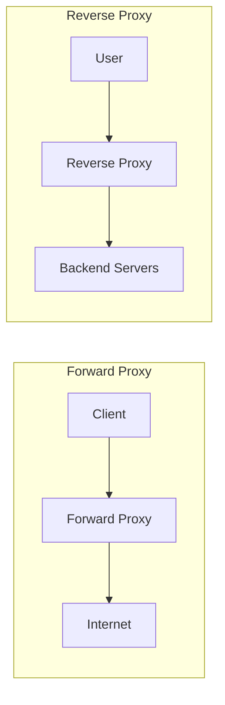

# Proxies in System Design 📌

## Table of Contents

- [Introduction](#introduction)
- [Prerequisites & Related Topics](#prerequisites--related-topics)
- [Pattern Recognition Guide](#pattern-recognition-guide)
- [Forward vs Reverse Proxies](#forward-vs-reverse-proxies)
- [What a Reverse Proxy Does](#what-a-reverse-proxy-does)
- [Deployment Topologies](#deployment-topologies)
- [Trade-offs](#trade-offs)
- [Edge Cases to Consider](#edge-cases-to-consider)
- [Common Pitfalls](#common-pitfalls)
- [FAQ](#faq)
- [Interview Tips](#interview-tips)
- [Real-World Examples](#real-world-examples)
- [Advanced Topics](#advanced-topics)
- [Further Reading](#further-reading)

## Introduction

A proxy is a middleman for network traffic. A **forward proxy** sits in front of *clients* and makes requests on their behalf (corporate egress, content filtering, anonymization). A **reverse proxy** sits in front of *servers* and accepts requests on their behalf — TLS termination, caching, compression, routing, and the first line of defense for a backend fleet.

## Prerequisites & Related Topics

- **Builds on**: HTTP fundamentals, TLS, [Load Balancing](load-balancing.md)
- **Used in**: [API Gateway](../architecture/api-gateway.md) (a gateway is a reverse proxy plus policy), [CDN & Content Delivery](cdn-content-delivery.md) (edges are reverse proxies with cache), [Rate Limiting](../architecture/rate-limiting.md)
- **Techniques often combined**: TLS termination, cache headers, health checks, connection pooling, mTLS
- **See also**: [Service Mesh](../cloud-native/service-mesh.md) — meshes do east-west proxying; reverse proxies do north-south

## Pattern Recognition Guide

### 🎯 When to Use a Reverse Proxy

**Keywords in requirements**: "TLS termination", "hide backend topology", "static content offload", "cache at the edge", "single entry point", "block before it hits the app"
**Reach for this when**:
- Clients must not see (or reach) backend addresses directly
- TLS certificates, compression, and cache headers should change in one place
- Static assets or cacheable responses should never reach app servers
- You need a standard chokepoint for auth headers, rate checks, or WAF rules

### 🔑 Approach Indicators

| Approach | Signals | Best For |
|----------|---------|----------|
| Plain reverse proxy (nginx, HAProxy) | routing + TLS + caching | most web/API fleets |
| Managed edge (CloudFront, Cloudflare) | cache + DDoS + WAF at the edge | internet-facing products |
| Forward proxy (Squid, egress filters) | *client*-side control | corporate/egress, compliance |
| Gateway/mesh edge (Envoy) | per-route policy, observability | microservices platforms |

### ❌ When NOT to Use

- One tiny service behind a cloud ALB — the managed balancer already covers it
- East-west service traffic — that's service-mesh territory
- Latency-critical internal hops that gain nothing from edge policy — route around it

## Forward vs Reverse Proxies

| Aspect | Forward Proxy | Reverse Proxy |
|--------|---------------|---------------|
| Represents | the client | the server |
| Who configures it | end user / IT admin | backend team |
| Typical job | egress control, filtering, anonymity | TLS, caching, routing, shielding |
| Visible to the counterpart | often hidden | almost always public entry point |
| Interview heuristic | "proxy for users" | "proxy for servers" |

**How it works — the shielding property:** a reverse proxy publishes one stable address (or several, behind its own balancers) while backends live on private subnets on ever-changing IPs; deploys, resizing, and provisioning changes become invisible to clients. Combine with health checks and connection draining for zero-downtime deploys.

## What a Reverse Proxy Does

- **TLS termination** — owns certificates; backends communicate plaintext inside a private network (or mTLS beyond it).
- **Caching & compression** — serves cacheable content from memory/disk (`Cache-Control`, gzip/brotli) so origin traffic drops by an order of magnitude for public content.
- **Routing** — path- and host-based dispatch (`/api/*` → API pool, `/*` → web pool).
- **Header surgery** — injects `X-Forwarded-For`, `X-Request-Id`, strips hop-by-hop headers; be aware clients can spoof these if you trust them blindly.
- **Security front line** — connection limits, IP allowlists, WAF signatures, padding against slow-loris-style attacks, first drop for malformed requests.
- **Connection pooling** — tens of thousands of client connections multiplexed onto a small pool of backend connections.

## Deployment Topologies

### 1. Single Tier
Client → reverse proxy → app servers. The default; pairs with an anycast or L4 tier in front for scale.

### 2. Tiered (L4 + L7)
Edge L4 gateway (billion-packet fast path) → L7 reverse proxies (HTTP-aware decisions). This is how hyperscalers push TLS off the "smart" tier.

### 3. Edge / CDN as the Reverse Proxy
The CDN PoP *is* a globally distributed reverse proxy with its own cache — origin servers see only misses.

## Trade-offs

| Choice | Pros | Cons | Best For |
|--------|------|------|----------|
| Reverse proxy in front of everything | one place for TLS/cache/security policy | extra hop, fleet to operate, SPOF if not HA | any multi-server public service |
| Managed cloud edge | no proxy fleet to own, DDoS absorbed | vendor lock-in, per-request cost | startups, bursty traffic |
| Self-managed (nginx/Envoy) | full control, cheap at scale | 24/7 ops, config drift risk | large platforms, custom routing |
| Forward proxy on the client side | egress control, audit | no protection for the servers | corporate/compliance environments |

**Shielding vs visibility:** the proxy hides backends but also obscures which server served a request — propagate request IDs end-to-end to keep debugging honest.

**Caching at the proxy vs origin:** proxy caching cuts latency and load, but shared caching of authenticated responses is a classic data-leak bug — vary carefully by auth scope.

> **⚠️ When NOT to put rich logic in the proxy:** business logic bends proxies into bespoke apps — keep to config-driven policy (auth, limits, routing); anything smarter belongs in a service.

## Edge Cases to Consider

- WebSocket / SSE / streaming uploads — ensure no response buffering in the hop
- `X-Forwarded-For` spoofing — trust only the edge-added values
- Cache stampede on expired hot objects at the edge — single-flight coalescing
- Client certificates / mTLS passthrough vs termination
- Hop-by-hop headers (Connection, Keep-Alive) leaking through translation
- Very large bodies — streaming, not buffering, or memory blowups

## Common Pitfalls

1. Trusting client-supplied `X-Forwarded-For` for rate limiting (spoofed → bypass)
2. Caching per-user responses in a shared edge cache without `Vary: Authorization`
3. Turning the proxy into an app server (logic creep)
4. No HA pair — the entry point dies, everything dies
5. Forgetting to drain connections on proxy deploys (in-flight request losses)

## FAQ

**Q1: Proxy vs load balancer?**

A: A reverse proxy *includes* distribution, but adds per-request policy — TLS, caching, header rewrites, routing rules. Interview one-liner: "a load balancer spreads; a reverse proxy mouths policy."

**Q2: Proxy vs API gateway?**

A: The gateway is a reverse proxy with API-shaped policy — auth, quotas, request/response transformation, per-route aggregation. Every gateway is a reverse proxy plus policy, not every proxy is a gateway.

**Q3: Forward or reverse proxy — which does the user see?**

A: Usually neither on purpose. Corporate users may be *forced through* a forward proxy; internet users hit your *reverse* proxy as your public entry point.

## Interview Tips

### 1. Key Considerations

- Where TLS terminates, and what protection exists between proxy and backend
- What's cached where, and how invalidation flows
- Forwarded-header trust model
- HA of the entry point itself

### 2. Common Questions

1. Design a reverse proxy for a global web application.
2. Where do TLS termination and re-encryption belong in your stack?
3. How would you prevent a backend's topology from being visible to clients?
4. When would you insert a WAF — at the reverse proxy or the gateway?

### 3. One-Liner to Land

"A reverse proxy is your single public mouth: terminate TLS, cache what's cacheable, hide the fleet, and enforce policy before anything reaches your app servers."

## Real-World Examples

- **nginx/HAProxy front door:** classic termination + static offload pattern; L7 routes by path, app servers never touch TLS.
- **Cloudflare/Fastly at the edge:** global reverse proxy + cache + DDoS scrubbing — origin sees only filtered misses.
- **Corporate egress via forward proxy:** all outbound HTTP routed through an auditable point for policy and logging.

## Advanced Topics

1. Envoy/Istio-style edge with per-route retries, outlier ejection, and circuit breaking
2. TLS passthrough vs termination vs re-encryption trade-offs (and mTLS beyond the edge)
3. Proxy-level caching with `stale-while-revalidate` and request coalescing
4. eBPF/XDP sockets for L4 proxying at the kernel boundary (e.g., Katran)

## Further Reading

- [NGINX Reverse Proxy Guide](https://docs.nginx.com/nginx/admin-guide/web-server/reverse-proxy/)
- [MDN: Proxy Server](https://developer.mozilla.org/en-US/docs/Glossary/Proxy_server)
- [HAProxy Documentation](https://www.haproxy.org/)
- [Envoy Proxy Documentation](https://www.envoyproxy.io/docs)
